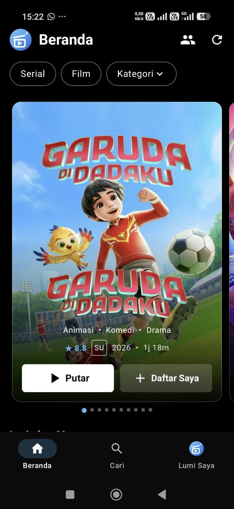
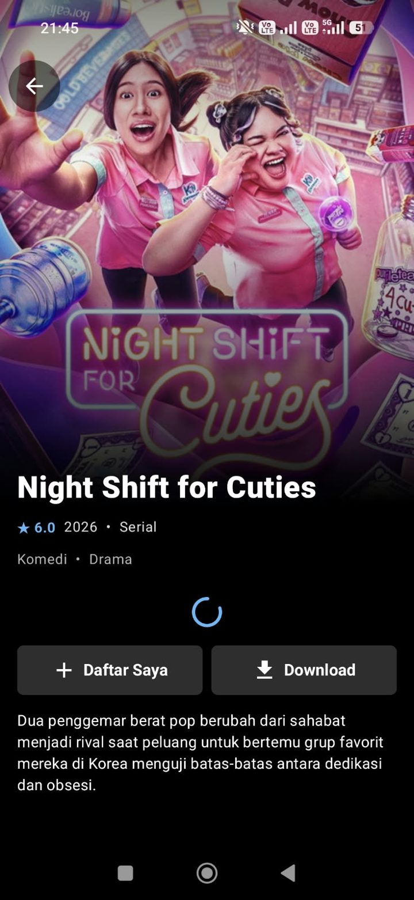
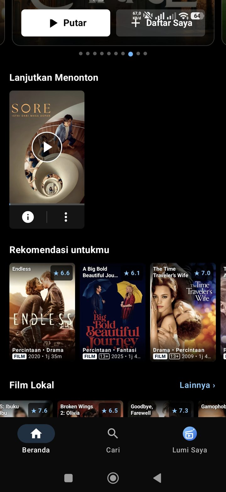
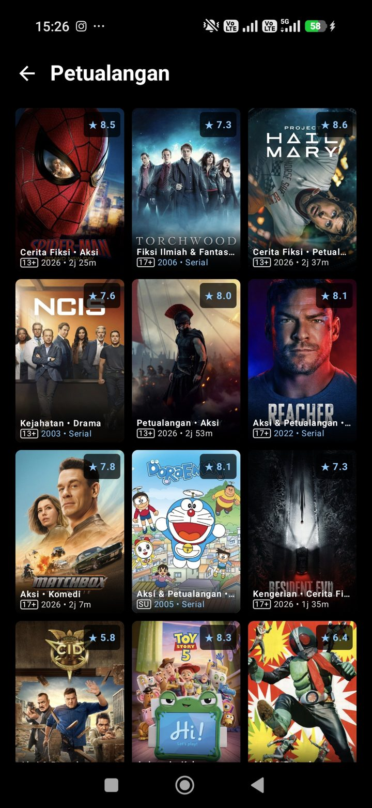

<div align="center">

# ✦ Lumi Box ✦

### Aplikasi nonton film & serial lokal maupun global untuk Android

*Katalog dari TMDB · video dari MovieBox · tanpa iklan · Nonton Bareng*

[](https://github.com/vickyvam72/LumiBox/releases/latest)
[](#-kebutuhan-sistem)
[](#%EF%B8%8F-teknologi)
[](#%EF%B8%8F-teknologi)
[](LICENSE)

**🌐 Bahasa / Language:** &nbsp; **🇮🇩 Bahasa Indonesia** &nbsp;|&nbsp; [🇬🇧 English](README.en.md)

[⬇️ Unduh](#%EF%B8%8F-unduh--pasang) · [📸 Tampilan](#-tampilan) · [✨ Fitur](#-fitur) · [📖 Panduan](#-panduan-pemakaian) · [❓ FAQ](#-faq--mengatasi-masalah) · [📝 Catatan Perubahan](CHANGELOG.md)

</div>

---

## 🌟 Kenapa Lumi Box?

> **Lumi Box** menggabungkan katalog film & serial yang rapi dari **TMDB** dengan video dari **MovieBox**, dibungkus tampilan ala aplikasi streaming besar, **tanpa iklan**.

| | |
|---|---|
| 🆕 **Selalu yang terbaru** | **Top 10** dan **Rilis Terbaru** lokal & global, diurutkan dari **tanggal rilis digital** dan diperbarui otomatis tiap hari. Yang masih tayang di bioskop tidak ikut. |
| 🇮🇩 **Lokal & global** | Film Lokal, Serial Lokal, Film Global, Serial Global. Judul lokal pakai bahasa Indonesia, judul luar negeri pakai bahasa Inggris. |
| ✅ **Hanya yang bisa ditonton** | Setiap judul dicek dulu ke MovieBox. Tombol **Putar** hanya muncul kalau videonya benar-benar ada. |
| ❤️ **Rekomendasi untukmu** | Tekan **Saya Suka** / **Bukan untuk Saya**, rekomendasi menyesuaikan genre, asal (lokal/global), dan jenis tontonanmu. |
| 🎬 **Pemutar ala bioskop** | Subtitle Indonesia otomatis, sinkron subtitle per 0,1 detik, kualitas otomatis, kecerahan, kunci layar, episode berikutnya. |
| 📥 **Download untuk offline** | Unduh film atau episode **beserta subtitlenya**, lalu tonton tanpa internet. |
| 👥 **Nonton Bareng** | Tonton bersama teman di HP masing-masing, **pas di detik yang sama**, cukup dengan kode room. |
| 🧹 **Saringan konten** | Drama pendek (DramaBox dkk.) dan film India/Bollywood disembunyikan secara bawaan, bisa dinyalakan di Setting. |
| 🔁 **Pulih otomatis** | Link video ditolak server? Lumi Box mencari link lain sendiri. Aplikasi gagal dibuka? Cache dibersihkan otomatis. |

---

## 📸 Tampilan

<div align="center">

| 🏠 Beranda | ℹ️ Halaman Info |
|:-:|:-:|
|  |  |
| **Rilisan terbaru langsung di depan mata.** Carousel atas berisi film & serial lokal dan global yang baru rilis. | **Info lengkap sebelum menonton.** Genre, rating umur, durasi, deskripsi berbahasa Indonesia, Putar, Daftar Saya, dan Download. |

| ❤️ Rekomendasi untukmu | 🗂️ Kategori |
|:-:|:-:|
|  |  |
| **Makin sering dinilai, makin pas.** Lanjutkan Menonton dan rekomendasi sesuai seleramu. | **Cari per genre & tahun.** Setiap poster memuat skor, genre, rating umur, tahun, dan durasi. |

</div>

---

## ✨ Fitur

### 🏠 Beranda
- **Carousel atas** berisi rilisan terbaru (film lokal & global, serial lokal & global), berganti tiap 2 detik dan bisa digeser
- **Lanjutkan Menonton**, lalu **Rekomendasi untukmu** begitu kamu mulai menilai judul
- **Top 10 Film Lokal** & **Top 10 Film Global**
- **Film Lokal Rilis Terbaru** & **Film Global Rilis Terbaru**, urut tanggal rilis digital, dengan **Lainnya ›**
- **Film Lokal, Serial Lokal, Film Global, Serial Global**, masing-masing dengan **Lainnya ›** dan filter tahun
- Chip **Serial / Film / Kategori** (genre) dengan filter tahun
- Poster lengkap: judul, skor, tag **FILM/SERIAL**, genre, rating umur, tahun, durasi
- Diperbarui otomatis: setiap aplikasi dibuka, dan setiap 3 jam kalau dibiarkan terbuka

### 🎬 Menonton
- Ketuk judul → **halaman info** dulu, putar lewat tombol **Putar**
- Audio bahasa asli (bukan dubbing), subtitle **Indonesia → bahasa asli**
- Kontrol: ±10 detik, kecepatan, kecerahan, kunci layar, pilih episode, **Eps. Berikutnya**, Audio & Subtitle, sinkron subtitle 0,1 detik
- Kualitas otomatis dengan cadangan; kalau semua link ditolak, Lumi Box meminta ulang ke semua jalur MovieBox
- Pengaman durasi: video yang jelas bukan judul ini tidak diputar diam-diam

### 👤 Lumi Saya
- **History** (dipisah Film / Serial), **Unduhan** (dipisah Film / Serial), **Setting**
- **Lanjutkan Menonton** dan **Daftar Saya**
- Menu ⋮ di setiap judul: Informasi, Download, Bukan untuk Saya, Saya Suka, **Hapus** (dari Lanjutkan Menonton & History)

### ⚙️ Setting
- **Kunci TMDB** (gratis) untuk poster, judul, dan daftar film
- **Konten:** tampilkan / sembunyikan drama pendek dan film India / Bollywood

---

## ⬇️ Unduh & Pasang

1. Buka halaman **[Releases](https://github.com/vickyvam72/LumiBox/releases/latest)**.
2. Di bagian **Assets**, unduh `LumiBox-v2.0.apk`.
3. Buka file yang sudah diunduh. Kalau Android meminta, izinkan **"Instal aplikasi tidak dikenal"** untuk browser atau pengelola file yang kamu pakai.
4. Tekan **Instal**. Selesai! 🎉

> 💡 **Update:** Cukup pasang APK baru di atas yang lama. History, Daftar Saya, unduhan, dan pengaturanmu tetap aman.

### 📋 Kebutuhan Sistem
- Android **8.0 (API 26)** atau lebih baru, prosesor ARM (arm64-v8a / armeabi-v7a)
- Ruang kosong sekitar **50 MB** (ditambah ruang untuk download)
- Koneksi internet (kecuali untuk tontonan yang sudah di-download)

---

## 📖 Panduan Pemakaian

### 0️⃣ Pertama kali dibuka
Lumi Box menampilkan dua layar singkat, masing-masing pas dalam satu layar tanpa perlu scroll:
1. **Perkenalan**: tekan **Hubungkan TMDB** dan tempel kunci API TMDB-mu, atau **Lewati dulu**.
2. **Satu langkah lagi**: izinkan **notifikasi** dan **berjalan di latar belakang**. Untuk HP Xiaomi, Oppo, Vivo, Realme, dan Infinix ada pilihan opsional **Mulai otomatis**.

### 1️⃣ Dapatkan kunci TMDB (gratis)
1. Daftar di [themoviedb.org](https://www.themoviedb.org/signup) lalu buka **Settings → API**.
2. Buat API key (pilih penggunaan pribadi).
3. Salin **API Key** atau **API Read Access Token**, lalu tempel di Lumi Box (**Lumi Saya → Setting**).

### 2️⃣ Menilai judul
Tekan ⋮ atau tahan poster → **Saya Suka** / **Bukan untuk Saya**. Judul yang tidak kamu suka disembunyikan, dan baris **Rekomendasi untukmu** muncul di atas Top 10.

### 3️⃣ Download untuk offline
Di halaman info tekan **Download** (atau ikon unduh di samping episode). Subtitle Indonesia, bahasa asli, dan Inggris ikut diunduh. Lihat hasilnya di **Lumi Saya → Unduhan**.

> ℹ️ Download hanya bisa untuk video berformat MP4. Sumber jenis streaming (DASH/HLS) hanya bisa ditonton online.

### 4️⃣ Nonton Bareng 👥
1. Tekan ikon 👥 di Beranda atau di pemutar → **Buat room**.
2. Bagikan kode 6 huruf ke temanmu. Temanmu menekan **Gabung** dan memasukkan kode itu.
3. Putar apa saja: HP temanmu ikut membuka judul yang sama, di posisi yang sama.
4. Host bisa mengizinkan anggota ikut mengatur pemutaran.

---

## ❓ FAQ & Mengatasi Masalah

<details>
<summary><b>Tulisan "Video untuk judul ini belum tersedia di MovieBox"</b></summary>

Lumi Box sudah mencari judulnya (termasuk judul Inggris & judul alternatif dari TMDB) tapi MovieBox belum punya videonya. Tekan **Periksa lagi** beberapa waktu kemudian.
</details>

<details>
<summary><b>Video tidak mau diputar (HTTP 403 / 429)</b></summary>

Lumi Box otomatis mencoba link lain dan jalur MovieBox lain. Kalau tetap gagal, tekan **Salin info teknis** di pemutar dan laporkan bersama judulnya.
</details>

<details>
<summary><b>Poster, judul, atau Top 10 tidak muncul</b></summary>

Pastikan kunci TMDB sudah diisi di **Lumi Saya → Setting**. Tanpa kunci, Lumi Box memakai katalog cadangan yang lebih terbatas.
</details>

<details>
<summary><b>Aplikasi force close. Bagaimana cara melaporkannya?</b></summary>

Saat dibuka lagi, Lumi Box menampilkan laporan error lebih dulu (termasuk crash native dan aplikasi macet di Android 11+). Tekan **Salin laporan**, lalu kirimkan bersama penjelasannya. Kalau aplikasi gagal dibuka, cache dibersihkan otomatis tanpa menghapus History, Daftar Saya, atau unduhan.
</details>

<details>
<summary><b>Kenapa ada film yang tidak muncul sama sekali?</b></summary>

Lumi Box hanya menampilkan judul yang sudah rilis digital dan ada di MovieBox. Drama pendek dan film India/Bollywood juga disembunyikan secara bawaan; nyalakan di **Setting → Konten** kalau ingin melihatnya.
</details>

---

## 🔒 Privasi

- ✅ **Tanpa** iklan, analitik, atau pelacak
- ✅ Kunci TMDB, History, Daftar Saya, dan penilaianmu hanya disimpan **di HP-mu**
- ✅ Perintah Nonton Bareng dienkripsi AES-GCM dengan kunci dari kode room, hanya peserta yang bisa membacanya
- ℹ️ Deskripsi yang belum berbahasa Indonesia diterjemahkan lewat Google Translate

---

## 🛠️ Teknologi

| Bagian | Teknologi |
|---|---|
| Aplikasi | **Kotlin**, **Jetpack Compose**, Material 3, Navigation Compose |
| Pemutar | **AndroidX Media3** (ExoPlayer), renderer subtitle sendiri (SRT/VTT/ASS) |
| Inti (core) | **Rust** ([MovieBox-Tui](https://github.com/mesamirh/MovieBox-Tui)) lewat JNI: tokio, reqwest, serde_json |
| Katalog | **TMDB API** (discover, rilis digital, terjemahan, gambar, rating usia) |
| Video | **MovieBox**: web H5, API aplikasi, dan apig, dicoba bersamaan |
| Gambar | Coil |
| Nonton Bareng | ntfy.sh + AES-GCM |
| CI/CD | GitHub Actions: setiap push mem-build dan merilis APK |

### 📁 Struktur proyek
```
core/      # Inti Rust (MovieBox-Tui): klien MovieBox, enkripsi, adaptor data
bridge/    # Jembatan JNI Rust → Android: stream, pencarian, detail (web/native/apig)
android/app/src/main/java/com/moviebox/app/
├── data/  # Repo, TMDB, Resolver (TMDB → MovieBox), Library, Downloads, Together, saringan konten
└── ui/    # Beranda, Info, Cari, Lumi Saya, Kategori, Onboarding, komponen
```

### 🏗️ Build dari kode sumber
```bash
git clone https://github.com/vickyvam72/LumiBox.git
cd LumiBox/bridge
cargo ndk -t arm64-v8a -t armeabi-v7a --platform 26 -o ../android/app/src/main/jniLibs build --release
cd ../android
gradle assembleRelease   # Gradle 8.11.1, JDK 17, Android SDK 35, NDK
```
APK hasil build ada di `android/app/build/outputs/apk/release/`.

> 🔐 Build rilis ditandatangani dengan kunci pribadi yang disimpan di **GitHub Actions Secrets** (`LUMIBOX_KEYSTORE_BASE64`, `LUMIBOX_KEYSTORE_PASSWORD`). Kunci tidak disimpan di repo. Untuk build lokal, taruh keystore milikmu di `android/app/moviebox-release.jks` dan isi variabel `LUMIBOX_KEYSTORE_PASSWORD`.

---

## 🙏 Terima Kasih

Lumi Box bisa berdiri berkat proyek dan layanan luar biasa berikut. **Terima kasih banyak** untuk para pembuat dan kontributornya! 💖

### 🧩 Kode, teknik, dan ide
| Proyek | Yang dipakai / dipelajari Lumi Box |
|---|---|
| [**MovieBox-Tui**](https://github.com/mesamirh/MovieBox-Tui) oleh mesamirh | Inti Rust: klien MovieBox, tanda tangan permintaan, adaptor data (MIT / Apache-2.0) |
| **Moviebox-API** & **moviebox-internal-api** oleh vickyvam72 | Jalur video web H5, identitas aplikasi terbaru, apig, dan cara memfilter video "notice" |
| [**LumiTube**](https://github.com/vickyvam72/LumiTube) oleh vickyvam72 | Cara kerja Watch Together (ntfy + AES-GCM), layar perkenalan, dan gaya dokumentasi |
| [**moviebox-api**](https://github.com/Simatwa/moviebox-api) oleh Simatwa | Pencarian web MovieBox (h5) dan cara mendapatkan cookie sesinya |
| **Stremio Cinemeta** & **EasyRatings** | Meta judul (IMDb) dan katalog cadangan saat kunci TMDB belum diisi |

### 🌐 Layanan
- [**TMDB**](https://www.themoviedb.org): poster, judul, deskripsi, genre, rating usia, Top 10, dan rilis digital
- **MovieBox**: sumber video dan subtitle
- [**ntfy**](https://github.com/binwiederhier/ntfy) oleh binwiederhier: server [ntfy.sh](https://ntfy.sh) yang meneruskan perintah Nonton Bareng
- **Google Translate**: terjemahan deskripsi ke bahasa Indonesia

> *This product uses the TMDB API but is not endorsed or certified by TMDB.*

### 📚 Library
[Jetpack Compose](https://developer.android.com/jetpack/compose) · [AndroidX Media3](https://github.com/androidx/media) · [Coil](https://github.com/coil-kt/coil) · [Kotlin Coroutines](https://github.com/Kotlin/kotlinx.coroutines) · [tokio](https://github.com/tokio-rs/tokio) · [reqwest](https://github.com/seanmonstar/reqwest) · [serde](https://github.com/serde-rs/serde) · [jni-rs](https://github.com/jni-rs/jni-rs) · [cargo-ndk](https://github.com/bbqsrc/cargo-ndk)

> Proyek-proyek di atas tidak berafiliasi dengan Lumi Box. Seluruh penghargaan atas karya mereka menjadi milik pembuatnya masing-masing.

---

## ⚖️ Penafian

Lumi Box adalah proyek independen untuk **penggunaan pribadi dan edukasi**.
Lumi Box **tidak menyimpan, mengunggah, atau menyediakan video apa pun**; semua video berasal dari layanan pihak ketiga yang dapat diakses publik.
Lumi Box **tidak berafiliasi dengan, didukung oleh, atau disponsori oleh MovieBox, TMDB, maupun pemilik film/serial mana pun**. Semua merek dagang dan karya adalah milik pemiliknya masing-masing.
Gunakan dengan risiko sendiri dan patuhi hukum hak cipta di negaramu.

## 📄 Lisensi

Hak cipta © 2026 **vickyvam72**.

Lumi Box dirilis di bawah **[GNU General Public License v3.0](LICENSE)**. Folder `core/` berasal dari [MovieBox-Tui](https://github.com/mesamirh/MovieBox-Tui) dan tetap mengikuti lisensi aslinya (MIT atau Apache-2.0).
Lumi Box diberikan **tanpa jaminan apa pun**. Lihat file [LICENSE](LICENSE) untuk teks lengkapnya (berbahasa Inggris).

<div align="center">

---

Dibuat dengan ❤️ di Indonesia · Kalau suka Lumi Box, beri ⭐ ya

</div>
